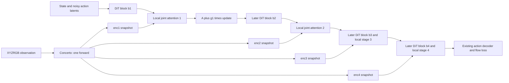

# Multi-level Local Point–Action Sidecar

`sidecar_variant: legacy` remains the default. `multilevel_local` adds a separate,
stage-aligned local joint-attention branch. It uses the existing flow loss,
checkpoint loader, trainer, optimizer ownership, Trainctl and W&B paths.



Inside each local stage:

1. Use the action latent immediately after the assigned DiT block.
2. Project stage features and their XYZ into the Sidecar width.
3. Split the first available PTv3 serialized order into contiguous patches,
   independently for each offset-defined batch segment.
4. Replicate projected action tokens into every local patch. Concatenate
   `[action; points]`, normalize, then run one QKV/SDPA joint self-attention.
   Point queries also attend to action keys. Padding keys are masked out.
5. Select the attention branch's action outputs, before any action residual.
   Average windows equally within each scene, project to the DiT width, multiply
   by the independent zero-initialized scalar gate and add to the current action.

There is **no subtraction** of the input action projection, no global learned
query pooling, FPS/KNN anchors, auxiliary loss or additional deep transformer.
A zero gate is an exact no-op for finite inputs; its gradient remains available.
Attention/projection gradients become nonzero after the gate opens.

## Configuration and tensors

The locally available official `concerto_small.pth` was inspected without running
training: `enc_mode=true`, `enc_depths=[2,2,2,6,2]`, and
`enc_channels=[32,64,128,256,512]`. Its actual modules are verified on construction
and selected feature widths are checked on extraction. This is not a fixed
fine/medium/coarse hierarchy. Other checkpoint layouts are resolved from their
saved `point_encoder_model_config`, not guessed from the model name.

```yaml
model:
  sidecar_variant: multilevel_local
  sidecar_num_stages: 4
  sidecar_stage_indices: null
  sidecar_point_stage_names: [enc1, enc2, enc3, enc4]
  sidecar_hidden_dim: 256
  sidecar_num_heads: 4
  sidecar_local_patch_size: 64
  sidecar_window_chunk_size: 16
  tactile_fusion_mode: none
  contact_input_mode: none
  temporal_window_size: 0
  contact_prediction_loss_weight: 0.0
```

`sidecar_stage_indices=null` uses the existing evenly distributed zero-based
DiT indices. With depth 16, they are `[3,7,11,15]`; actual checkpoint depth owns
this calculation. Explicit point mapping must have one **distinct, existing**
stage per actual injection block. An omitted point mapping selects the last
available encoder stages and persists their resolved names. Encoder-only and
encoder/decoder Concerto configs are accepted. In decoder mode snapshots are
captured before unpooling can mutate parent Point objects.

| Tensor | Shape / meaning |
|---|---|
| Raw input | `[B,N,6]`, XYZRGB; encoder interface also accepts `[B,N]` valid mask |
| Each packed level feat | `[sum_b N_level,b, d_level]` |
| Each coord / offset | `[sum_b N_level,b,3]` FP32 / `[B]` cumulative integer counts |
| Grid / serialization | Corresponding grid coordinates / `[orders,sum_b N_level,b]` |
| Current action latent | `[B,H,d_action]`; `d_action=DiT.inner_dim` |
| Per chunk joint tokens | `[C,H+K,256]`, `C <= window_chunk_size`, `K=patch_size` |
| Aggregated attention branch | `[B,H,256]` |
| Injected residual / output | `[B,H,d_action]` |

The default config's DiT width is 1536; the loaded checkpoint remains authoritative.
CPU tests use action latents `[2,4,8]`, packed point counts `[5,3]` and mock encoder
widths `[4,6,8,10,12]`; the flow-head tests produce actions `[2,4,7]`.

The encoder retains the existing per-scene CenterShift (XY bounding-box center,
minimum Z). XYZ used by positional projection is in **that same centered metric
frame**, without per-window recentering or mixing raw world coordinates. This
architecture does not restore absolute translations removed by CenterShift.

## Training, inference and resume

Run from the repository root in the existing environment. These commands start
training only when explicitly executed by the operator. Defaults match the existing
Florence full-dataset, non-temporal conditions; no training was launched as part
of implementation. The dataset defaults to `data/univtac` and can be selected with
`FLORENCE_DATASET`. It must be an existing converted UniVTAC dataset; the launcher
does not create it or fall back to the five-episode overfit subset. The default
hardware preset is four BF16 ZeRO-3 GPUs and the default training length is 10,000
steps.

```bash
# Read-only config composition/preflight; no model weights or dataset are loaded.
.venv/bin/python scripts/train_hydra.py \
  --config-name experiment/wah_multilevel_local_frozen dry_run=true

# Full UniVTAC training. The Concerto checkpoint may be supplied with
# FLORENCE_CONCERTO_CHECKPOINT or resolved by the existing loader.
export FLORENCE_DATASET=/path/to/full_univtac_dataset

CUDA_VISIBLE_DEVICES=0,1 \
uv run --no-sync python scripts/train_hydra.py \
  --config-name experiment/wah_multilevel_local_full \
  hardware=dual_3090_zero3 \
  trainctl.enabled=true \
  trainctl.message_mode=koyori \
  training.max_steps=10000

# Replace the config name for the other two modes:
# experiment/wah_multilevel_local_frozen
# experiment/wah_multilevel_local_lora
```

All three configs use the same full dataset and do not set
`data.expected_episode_ids`. `frozen` keeps the pretrained DiT frozen, `lora`
adds LoRA to the existing DiT attention modules, and `full` trains the original
DiT parameters. Here, **`full` means DiT full fine-tuning; it does not mean a
different dataset size**. `FLORENCE_OVERFIT_DATASET` and
`data.expected_episode_ids=null` overrides are not needed.

Hardware, dataset and Trainctl overrides use the existing Hydra launcher. The
Sidecar remains in the action-head optimizer group. The new local stage projections
replace the unused legacy point projection, which is frozen only in the new variant.
DiT LoRA stays restricted to original DiT attention modules. Full mode trains the
original DiT; frozen mode preserves it. Use `training.max_steps=1` for a manually
requested real one-step smoke; it still requires the real model, data and GPUs.

Resume uses the original experiment/output directory and existing optimizer,
scheduler and RNG state:

```bash
.venv/bin/python scripts/train_hydra.py \
  --config-name experiment/wah_multilevel_local_frozen \
  output_dir=/path/to/original/run resume.enabled=true \
  resume.checkpoint_path=/path/to/original/run/checkpoint-100
```

Retain the original resolved dataset/model overrides on resume. Hydra validates
architecture and optimizer compatibility. Old Hydra snapshots lacking the new
fields are interpreted using legacy defaults.

Checkpoints persist the variant, resolved point mapping, full Concerto architecture,
patch/chunk sizes and ordinary weights. HF and setup loaders reject cross-variant
WAH checkpoint overrides. Original NVIDIA checkpoints can bootstrap newly initialized
local adapters and official pretrained sensor backbones; existing WAH adapter
weights are never automatically transplanted. Saved exports reload without the
external Concerto file. The existing inference server selects the saved variant:

```bash
.venv/bin/python gr00t/eval/run_gr00t_server.py \
  --model-path /path/to/exported_checkpoint --embodiment-tag new_embodiment
```

The supplied ablations inherit the existing UniVTAC tactile dataset/processor
contract; tactile injection is disabled, as in the reference point-only ablation.
New combinations with Temporal Fusion, Contact-MoE, legacy tactile injection or
Contact loss/warmup fail explicitly. These modules remain supported by `legacy`.

## Memory, diagnostics and validation

Selected encoder boundary tensors are cloned to protect against mutable PTv3
Point/decoder updates, without detaching autograd. Only tensor fields are retained.
One encoder forward serves all denoising steps; action-dependent joint attention
runs anew for each step. Window chunking bounds simultaneous attention matrices;
there is no global pooling fallback. Raw stage tensors are reused, while projection
and joint attention are recomputed per flow step.

Local stages are ZeRO-3 leaves so ranks with different point/window counts gather
parameters once per stage. Non-reentrant activation checkpointing re-enters the
whole stage module, preserving its gather hooks. Existing Concerto FP32 geometry,
FP16 sparse compute island and dense dtype transitions are retained. GPU collective
and spconv execution still need real multi-GPU validation.

With the existing diagnostic observer enabled, JSONL records preserve
`sidecar_stage_mapping` with point stage name, DiT block, point counts, window
counts, each window's valid point count, scalar gate, point/action feature norms,
pre-gate action update norm, injected residual norm and injection ratio. Scalar
`sidecar_local/*_stage_*` metrics flow through existing W&B logging. The new branch
has no `point_gate`; it is reported as unavailable, not synthesized. Existing
training-free evaluation and offline JSONL export accept the new mapping.

```bash
TEST_CACHE_PATH=/tmp/wah-test-cache NO_ALBUMENTATIONS_UPDATE=1 \
.venv/bin/python -m pytest tests/gr00t/model/test_multilevel_local_sidecar.py \
  tests/gr00t/model/test_sidecar_dit.py -m 'not gpu' -q

# Optional small CUDA-only optimizer smoke, explicitly requested by the operator:
.venv/bin/python -m pytest tests/gr00t/model/test_multilevel_local_sidecar.py \
  -m gpu -q
```

CPU tests cover batch isolation, action replication, equal window aggregation,
padding/zero gates, gradient flow, stage/current-latent mapping, BF16/FP16 local
attention, checkpointed flow backward, optimizer ownership, configuration,
diagnostics and HF save/reload/base bootstrap. GPU OOM/performance, real Concerto
spconv forward and multi-rank ZeRO-3 training/resume have not been validated here.

Design references: [PointACT action attention](https://github.com/cshizhe/robot-PointAct/blob/main/pointact/model/ptv3/concerto/model_ca_action.py)
and [official Concerto PTv3 stage/serialization implementation](https://github.com/Pointcept/Concerto/blob/main/concerto/model.py).

Broader regression note: the pre-existing Hydra defaults comparison expects direct
FinetuneConfig `save_steps=100`, while the unchanged Hydra finetune preset uses
`500`. That unrelated assertion remains failing; neither training default nor
test expectation was changed. Trainctl IPC smoke passed outside the filesystem/
socket sandbox.

## Implementation map

- `gr00t/model/extension/multilevel_local_sidecar.py`: local SDPA, snapshots,
  packed-level validation, zero gate and stage statistics.
- `gr00t/model/extension/point_encoder.py`: separate multi-level extraction API
  and real checkpoint metadata inspection; legacy forward API is unchanged.
- `gr00t/model/extension/sidecar_dit.py`: variant dispatch at existing injection
  blocks and whole-stage activation checkpointing.
- `gr00t/configs/sidecar_config.py`: dependency-free validation for dry-run,
  checkpoint mapping and cross-variant compatibility.
- `gr00t/configs/model/gr00t_n1d7.py`, `gr00t/configs/finetune_config.py`,
  `gr00t/configs/hydra_config.py`, `gr00t/experiment/launch_finetune.py`:
  HF/direct-launch/Hydra configuration propagation.
- `gr00t/model/gr00t_n1d7/{gr00t_n1d7,setup,pretrained_loading}.py`:
  actual train/inference encoding, checkpoint architecture verification,
  missing-adapter initialization and NVIDIA base bootstrap.
- `gr00t/experiment/{multimodal_diagnostics,sidecar_evaluation,hydra_launch}.py`:
  training/evaluation/offline stage mapping and historical resume defaults.
- `gr00t/policy/gr00t_policy.py`: variant-aware restoration and inference metadata.
- `configs/experiment/wah_multilevel_local_base.yaml`: shared full-UniVTAC,
  non-temporal Multi-level Local base.
- `configs/experiment/wah_multilevel_local_{frozen,lora,full}.yaml`: separate DiT
  training modes inheriting that base, without replacing existing presets.
- `tests/gr00t/model/test_multilevel_local_sidecar.py`: CPU mock coverage and
  opt-in GPU optimizer smoke. The existing diagnostics README/CLI were extended
  to expose this architecture's stage mapping.
