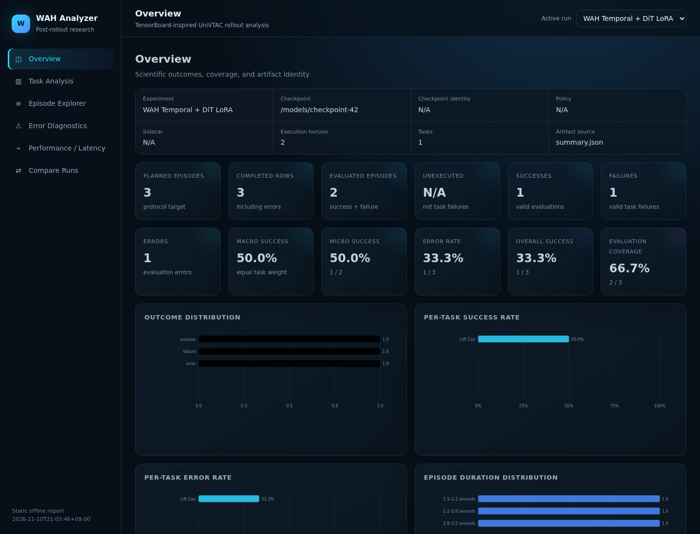

# GR00T + UniVTAC closed-loop rollout guide

## Unified split and local launchers

Both launchers call `scripts/run_gr00t_univtac_rollout.sh`, which retains the
existing task loop, worker isolation, MP4 recording, and CSV/JSON summaries.
`--policy auto` reads the loaded checkpoint's processor modalities through the
server. It never chooses a policy from a checkpoint directory name. The server's
`get_model_info` endpoint reports the loaded checkpoint identity, DiT mode,
Sidecar type, LoRA state, modality windows, and action horizon. The runner hashes
the local checkpoint's model weights, config, and processor config and compares
the hash with the server. In split mode, keep a byte-identical local copy of the
inference checkpoint, or pass its server-generated `--checkpoint-identity` when
the weights are remote-only. The local and remote paths may differ.

Prerequisites on the simulator workstation: a compatible UniVTAC checkout,
`UNIVTAC_ROOT`, `UNIVTAC_EXPECTED_PYTHON`, and
`UNIVTAC_PYTHON_COMMAND` (the Isaac-compatible Python launcher). The Isaac
environment needs `numpy`, `pyzmq`, and `msgpack`. Local mode additionally
needs the repository's separate `.venv/bin/python` with GR00T installed, or
`--model-python /path/to/model/python`. Do not use the same Python executable
for the two processes. The supported UniVTAC branches and Isaac versions are
in the table below; Isaac Sim 6.0.1 is not supported by this checkout.

## Live rollout dashboard

The local and split deployment launchers now keep the terminal in the control
process and render rollout telemetry there. The Isaac evaluator and per-task
workers still write ordinary UTF-8 logs, so no Rich control sequences enter
persistent files. `--dashboard auto` (the default) uses Rich only for a TTY and
emits concise text updates when redirected. `on` requests Rich when a TTY is
available; `off` disables display output. SSH and tmux resizing is handled by
Rich, and the display is closed during normal shutdown, exceptions, Ctrl+C, and
SIGTERM.

```bash
bash scripts/run_gr00t_univtac_local.sh \
  --checkpoint "$CHECKPOINT" --policy auto \
  --model-python .venv/bin/python --model-device cuda:0 --sim-device cuda:0 \
  --mode smoke --episodes-per-task 1 --tasks lift_can \
  --execution-horizon 1 --dashboard auto --dashboard-refresh 1.0 \
  --episode-telemetry-interval 1.0 --gpu-telemetry-interval 5.0 \
  --log-level normal --rollout-diagnostics standard --output-dir "$OUT"
```

The dashboard has three independent counters: overall completed/planned
episodes, completed/planned episodes for the active task, and executed
actions/the episode step limit. Only `episode_completed` advances the first two
counters. Rate-limited episode and inference events update the active phase and
action counter. Routine worker telemetry defaults to one event per second;
completion and critical failure events are immediate. The dashboard continues
refreshing elapsed time when no new event arrives, so a long GR00T request stays
visibly in `GR00T inference` without falsely advancing an action.

GPU sampling is independent of event consumption. `--gpu-telemetry-interval
5.0` is the default, and `--gpu-sampling-timeout 2.0` bounds each `nvidia-smi`
call. Samples never overlap; a failure keeps the last valid sample, or displays
`N/A` if none has succeeded.

ETA excludes setup and uses a bounded history of episode durations. It prefers
task-specific history after two samples and otherwise uses global history after
three. Until then it displays `Estimating...`; it is an estimate, not a
deadline.

Success means the task completed. Failure means a valid evaluation ended in
`step_limit` or `early_stop`. Error means evaluation/infrastructure trouble such
as `invalid_action`, `exception`, or `worker_failure`. The reported rate is:

```text
success_rate = successes / (successes + failures)
```

Errors are excluded; zero evaluated episodes display `N/A`. Micro success rate
uses all valid episodes. Macro success rate averages per-task rates and remains
`N/A` if a selected task has no valid evaluation. Error rate is errors divided
by total completed episodes. An initialization failure also records how many
episodes were never executed instead of presenting them as robot failures.

### Diagnostic levels and telemetry artifacts

Ordinary worker logging and structured diagnostics are separate:

- `--log-level quiet`: essential lifecycle failures only.
- `--log-level normal` (default): task/episode lifecycle and warnings.
- `--log-level debug`: detailed per-action phase, action, and observation
  messages. Debug output is buffered rather than flushed line by line.

Structured progress is available at every log level.

- `--rollout-diagnostics off`: lifecycle/progress only.
- `standard` (default): low-overhead action ranges, corrections, limit/saturation,
  smoothness/tracking summaries, input availability, temporal window state,
  action horizon, inference latency, and FPS.
- `full`: additionally samples observation shapes/non-finite ratios and the raw,
  corrected, executed, and post-action observed qpos values. Use
  `--diagnostic-sample-every N` (default 10) to control detailed sampling.

These diagnostics do not compare commanded qpos with “ground truth”; the
post-action difference is labeled joint tracking error. They reuse arrays already
on CPU and do not add per-action CUDA synchronization. Small DOF 7 corrections
remain corrections, not episode errors.

Additional artifacts are written under `logs/`:

- `rollout_events.jsonl`: newline-terminated, idempotent structured events;
  readers ignore a killed writer's partial final record.
- `worker_results/<task>.json`: the existing atomic partial result and crash
  recovery source.
- `<task>.log`, `rollout.log`, and `server.log`: full worker/control diagnostics.
- `latency_metrics.json`: evaluator and worker stage timings.
- `monitor_latency_metrics.json`: controller event, parsing, rendering, and GPU
  collection timings.

Each timing stage reports count, mean, p50, p95, maximum, and total
milliseconds. Profiling uses `time.perf_counter_ns()` and does not synchronize
CUDA. Disable it with `--no-profile-runtime`. Add `--gpu-sync-profile` only for
an explicitly diagnostic run that needs GPU-complete inference timings; it
calls `torch.cuda.synchronize()` and adds overhead.

If no action completes for 30 seconds, the dashboard shows a nonfatal warning
with phase, last action, and server status. Configure it with
`--stall-warning-seconds`. This does not cancel a legitimate long request or
change `--request-timeout-seconds`. `Episode reset` identifies environment
initialization, `GR00T inference` a pending model request, and `Executing action`
simulation/observation work.

Disable rendering with `--dashboard off`; JSONL telemetry and trainctl lifecycle
events continue. For detailed diagnosis:

```bash
bash scripts/run_gr00t_univtac_local.sh \
  --checkpoint "$CHECKPOINT" --model-python .venv/bin/python \
  --mode smoke --episodes-per-task 1 --tasks lift_can \
  --dashboard auto --log-level debug --rollout-diagnostics full \
  --diagnostic-sample-every 1 --gpu-sync-profile --output-dir "$OUT"
```

The CPU-only fake-worker benchmark does not claim GPU or Isaac speedups:

```bash
.venv/bin/python benchmarks/univtac_monitoring_benchmark.py \
  --actions 300 --action-seconds 0.01 \
  --output /tmp/univtac-monitoring-benchmark.json
```

The evaluator continues to create `episodes.csv`, `summary.csv`, `summary.json`,
`summary.txt`, `summary.md`, `runtime_metadata.json`, and episode videos. It still
refuses an output directory containing prior evaluation results.

### WAH Rollout Analyzer (post-rollout HTML)

`scripts/report_univtac_rollout.py` turns existing result artifacts into a polished,
static, offline research dashboard. It is postprocessing only: it does not import
Isaac Sim, load a model, contact a server, or modify the rollout directory's source
artifacts. The report includes Overview, Task Analysis, Episode Explorer, Error
Diagnostics, Performance / Latency, and Compare Runs views. MP4s remain separate
files and are linked with HTML5 video controls rather than embedded as base64.



Generate a single-run report (the default output is `$RUN/report/index.html`):

```bash
python scripts/report_univtac_rollout.py --run "$RUN"
```

Compare a GR00T action-head fine-tuned baseline with WAH Temporal Sidecar + DiT LoRA:

```bash
python scripts/report_univtac_rollout.py \
  --run /results/gr00t_action_head_baseline \
  --run /results/wah_temporal_dit_lora \
  --label "GR00T Baseline" \
  --label "WAH Temporal + DiT LoRA" \
  --output /results/comparison/index.html
```

The output is one `index.html`; videos and logs stay under their original rollout
roots. Open it directly, or use a local server if the browser restricts `file://`
video playback:

```bash
python -m http.server --directory /results 8000
# Visit http://localhost:8000/comparison/
```

Success, failure, and error have distinct meanings. **Success Rate** is
`successes / (successes + failures)`, matching `core.py`; evaluation errors are
excluded. **Overall Success Fraction** is `successes / completed rows`, so an
error-heavy experiment is not presented as healthy. **Error Rate** is
`errors / completed rows`. Macro success gives each selected task equal weight;
micro success pools all valid evaluated episodes. **Evaluation Coverage** is valid
evaluated episodes divided by planned episodes when the plan is known. Unknown
metrics display `N/A`, never a fabricated zero.

Error Diagnostics preserves original text while grouping evidence for invalid
actions, joint-limit violations, NaN/Inf, shape mismatch, missing modalities,
timeouts, server failures, and worker failures. Joint/DOF values and bounds appear
only when recorded in artifacts. If action-level evidence is absent, rerun the
evaluation with `--rollout-diagnostics full --diagnostic-sample-every 1`; the report
never infers a root cause from missing data.

For comparison, the analyzer checks recorded tasks, seed start, episode count,
execution horizon, step limit, task configuration, instruction type, policy type,
dataset, and environment metadata. It warns when recorded protocols differ, treats
missing tasks as `N/A`, and labels results paired only when task/seed matches exist.

Known limitations: old runs can expose only fields they recorded; some protocol
metadata is absent from current `summary.json`; exact percentile aggregation across
worker summaries is not reconstructable without raw samples; and browsers vary in
their support for local MP4 playback. Report generation is intentionally standalone
and is not currently invoked automatically by the rollout launcher, so report
failures cannot affect rollout exit semantics.

### trainctl rollout supervision and notifications

Add `--trainctl-enabled` to the local or split launcher. The deployment controller
runs a lightweight bridge with `--model-python` (normally `.venv/bin/python`),
where the pinned trainctl package is installed; trainctl is not required inside
Isaac Python. trainctl supervises the evaluator/bridge process, while the outer
controller continues to own the terminal dashboard. SDK finish/fail annotations
never replace the evaluator's real exit code.

```bash
export TRAINCTL_DISCORD_WEBHOOK_URL='<set-in-your-secret-manager>'
# Telegram can be used instead or alongside Discord:
export TRAINCTL_TELEGRAM_TOKEN='<bot-token>'
export TRAINCTL_TELEGRAM_ALLOWED_USERS='<numeric-user-id>'

bash scripts/run_gr00t_univtac_local.sh \
  --checkpoint "$CHECKPOINT" --policy wah \
  --sensor-contract /path/to/dataset/meta/modality.json \
  --model-python .venv/bin/python --mode smoke --episodes-per-task 1 \
  --tasks lift_can --execution-horizon 1 --output-dir "$OUT" \
  --trainctl-enabled --trainctl-message-mode koyori \
  --rollout-message-style 1 --notify-task-complete
```

Modes are `standard`, `koyori`, `roboco`, `neuro`, and the backward-compatible
identifier `sopia` (`sophia` is accepted as an alias). Styles 1, 2, and 3 are the
deterministic Rollout variants from the TrainCTL message specification. Training
persona definitions are unchanged. Character dialogue is used for start,
halfway, successful completion, and critical abort. Task completion and nonfatal
episode errors use factual templates. If the rollout completes with error
episodes, the final message omits optimistic character completion dialogue.

Notifications are deduplicated: one start, one global halfway message, one per
task completion, the first occurrence of each nonfatal error category, throttled
aggregates for repeats, and one final completion/abort. Transport failures are
safe warnings and cannot stop simulation. An explicitly requested but missing
trainctl installation fails early with an actionable `uv sync --locked` message.

For the full canonical evaluation:

```bash
bash scripts/run_gr00t_univtac_local.sh \
  --checkpoint "$CHECKPOINT" --policy wah \
  --sensor-contract /path/to/dataset/meta/modality.json \
  --model-python .venv/bin/python --model-device cuda:0 --sim-device cuda:0 \
  --mode full --tasks all --execution-horizon 1 \
  --dashboard auto --rollout-diagnostics standard \
  --trainctl-enabled --trainctl-message-mode sopia --rollout-message-style 2 \
  --output-dir "$OUT"
```

Common preflight failures are explicit: missing simulator FFmpeg, missing/empty
checkpoint weights, missing sensor contract, occupied local server port, wrong
Python/runtime packages, unwritable output, and insufficient temporary filesystem
space. For `[Errno 28]`, inspect all four filesystem rows rather than only the
output mount. A server crash reports its PID/exit code, current phase, server log,
and causes a nonzero supervised exit while preserving partial results.

### Split mode: externally managed remote server

On the GPU server:

```bash
bash scripts/run_gr00t_univtac_server.sh \
  --checkpoint "$REMOTE_CHECKPOINT" --embodiment-tag NEW_EMBODIMENT \
  --device cuda:0 --host 127.0.0.1 --port 5555
```

If using SSH forwarding, run this separately on the simulator workstation:

```bash
ssh -N -L 5555:127.0.0.1:5555 user@gpu-server
```

RGB baseline smoke rollout, with `CHECKPOINT` pointing to the local copy:

```bash
bash scripts/run_gr00t_univtac_split.sh \
  --checkpoint "$CHECKPOINT" --policy auto \
  --server-host 127.0.0.1 --server-port 5555 \
  --mode smoke --episodes-per-task 1 --tasks lift_can \
  --execution-horizon 1 --sim-device cuda:0 --output-dir "$OUT"
```

The split launcher retries readiness until `--startup-timeout` expires. It
never starts or stops the remote server. A disconnected server or checkpoint
mismatch stops the run with an explicit error.

For a remote-only checkpoint, obtain its content identity on the GPU server:

```bash
CHECKPOINT_ID=$(.venv/bin/python -c \
  'from examples.UniVTAC.univtac_rollout.checkpoint import checkpoint_identity; import sys; print(checkpoint_identity(sys.argv[1]))' \
  "$REMOTE_CHECKPOINT")
```

Pass `--checkpoint "$REMOTE_CHECKPOINT" --checkpoint-identity "$CHECKPOINT_ID"`
to the split launcher. The local path then acts as a result label; verification
uses the exact server-generated SHA-256 identity. Keep the identity with the
checkpoint artifact so an incorrect server cannot be accepted by path alone.

### Local mode: two isolated processes

The local launcher checks the port, starts only its own GR00T server, waits for
readiness and checkpoint verification, runs the shared evaluator, then stops
its server on completion, failure, SIGINT, or SIGTERM. It never kills a service
that was already bound to the requested port.

```bash
bash scripts/run_gr00t_univtac_local.sh \
  --checkpoint "$CHECKPOINT" --policy auto \
  --model-python .venv/bin/python --model-device cuda:0 --sim-device cuda:0 \
  --server-port 5555 --mode smoke --episodes-per-task 1 --tasks lift_can \
  --execution-horizon 1 --output-dir "$OUT"
```

Use `--model-visible-devices 1 --sim-visible-devices 0` to isolate physical
GPUs. Each process then sees its own `cuda:0`; record both visibility masks and
device arguments when comparing runs. The launcher's `nvidia-smi` diagnostic
records GPU model, total and free VRAM before launch, after model loading,
after simulator initialization when observed, and peak used VRAM during the
rollout. These observations are warnings, not a guarantee that a 24 GB card
can fit both processes. CUDA OOM and process crashes preserve logs and exit
nonzero. `--startup-timeout` and `--retry-interval` control readiness waiting.

Both launchers use the hierarchical dashboard described above. Interactive
terminals update in place; redirected and non-TTY SSH jobs emit plain lines with
overall, task, action, phase, elapsed, and ETA fields and no ANSI escapes. Full
Isaac diagnostics remain in `logs/rollout.log` and per-task logs; server
diagnostics remain in `logs/server.log`. `summary.json` stays authoritative.

### WAH Temporal and MoE smoke rollouts

For either launcher, choose a complete checkpoint for the desired Temporal or
MoE Sidecar and DiT LoRA or full fine-tuning run. The server reads those choices
from model config and verifies that Sidecar and LoRA weights were restored.
Temporal windows come from the checkpoint processor's `delta_indices`.
For example, the current Temporal configuration uses state and scene point
cloud `[-4,-3,-2,-1,0]` and tactile `[-5,-4,-3,-2,-1,0]`.

```bash
# Temporal Sidecar + DiT LoRA
CHECKPOINT=/path/to/temporal-lora-checkpoint
bash scripts/run_gr00t_univtac_local.sh \
  --checkpoint "$CHECKPOINT" --policy wah \
  --sensor-contract /path/to/training-dataset/meta/modality.json \
  --scene-calibration /path/to/scene-calibration.json \
  --model-device cuda:0 --sim-device cuda:0 \
  --mode smoke --episodes-per-task 1 --tasks lift_can --execution-horizon 1 \
  --output-dir "$OUT"

# MoE Sidecar + DiT LoRA; remote server already running
CHECKPOINT=/path/to/local-copy-of-moe-lora-checkpoint
bash scripts/run_gr00t_univtac_split.sh \
  --checkpoint "$CHECKPOINT" --policy wah \
  --sensor-contract /path/to/training-dataset/meta/modality.json \
  --scene-calibration /path/to/scene-calibration.json \
  --server-host 127.0.0.1 --server-port 5555 \
  --mode smoke --episodes-per-task 1 --tasks lift_can --execution-horizon 1 \
  --sim-device cuda:0 --output-dir "$OUT"
```

The sensor contract is the exact `meta/modality.json` produced alongside the
training dataset. It supplies scene point count, voxel size, workspace crop,
sampling seed, coordinate frame, and the tactile training source key. The
optional scene calibration JSON follows the converter's `cameras.head` and
`cameras.wrist` schema: pinhole `intrinsics`, `depth_scale` to metres, static
head `T_base_camera`, and wrist `T_ee_camera`. The wrist transform is composed
with the current `embodiment.ee` pose. A per-frame `T_base_camera` supplied by
UniVTAC overrides calibration. The simulator must provide actual aligned head
and wrist depth; the adapter will not invent point clouds. If the training
source is `tactile/.../rgb`, the simulator must expose actual `tactile.rgb`.
If it exposes only `rgb_marker`, use a checkpoint trained from that stream or
collect the required raw tactile stream. Camera RGB cannot replace tactile.

To run all canonical tasks, replace `--mode smoke --episodes-per-task 1 --tasks
lift_can` with `--mode full --tasks all`. `--seed-start`, `--step-limit`, and
`--execution-horizon` retain their existing meanings. Both RGB and WAH execution paths use
the same Panda gripper safety postprocessing. DOF 7 overshoots no larger than
`--gripper-limit-tolerance-m` (default `1e-4` m) are corrected to the articulation boundary;
all arm-joint violations, larger gripper violations, and NaN/Inf are rejected. Every
correction records the original action, corrected action, and correction vector in the task
log. Every run writes
`summary.json`, `summary.csv`, `episodes.csv`, `videos/`, `logs/`, and
`runtime_metadata.json` under its output directory. By default the launchers
use `outputs/rollouts/<checkpoint-name>/<timestamp>/`. Supply a fresh
`--output-dir` for each run.

Native ZeRO-3 directories are not inference checkpoints. Export one with
`python scripts/export_zero3_checkpoint.py CHECKPOINT OUTPUT` before starting
the server. If WAH startup reports missing Sidecar or LoRA weights, verify the
export includes all model shards. If WAH fails with missing camera intrinsics,
depth, wrist extrinsics, or tactile source, fix the UniVTAC sensor output or
calibration; the runner deliberately rejects fabricated data.

The GR00T server and UniVTAC simulator intentionally run in separate Python environments:

- The SPL server runs `gr00t/eval/run_gr00t_server.py` and owns the checkpoint.
- The local machine runs UniVTAC and Isaac Sim and reaches the server through the SSH tunnel.
- The rollout is a real observation → inference → qpos action → simulator step → new observation loop.

## Supported simulator combinations

Use the environment that matches the checked-out UniVTAC code and task YAML. The worker validates this before starting Kit.

| UniVTAC code/config | Isaac Sim | Isaac Lab | Python |
|---|---:|---:|---:|
| `main` (flat `observations` config) | 4.5.x | release v2.1.1 (package 0.41.3) | 3.10 |
| `isaac51` (nested `env_settings` config) | 5.1.x | 2.3.0 | 3.11 |

Isaac Sim 6.0 / Isaac Lab 3.0 is not supported by either official UniVTAC branch. UniVTAC also requires its vendored `tacex`, `tacex_assets`, `tacex_uipc`, `uipc`, and pinned cuRobo modules. Keep any compatible UniVTAC environment isolated; do not downgrade or overwrite an existing Isaac Sim 6.0 installation.

The current public UniVTAC policy checkpoints and Isaac 4.5 demonstrations are associated with `main`. When evaluating a GR00T checkpoint trained from that data, prefer an isolated `main` + Isaac Sim 4.5 + Isaac Lab 2.1.1 environment unless the training data was explicitly produced by `isaac51`.

## 1. SPL server: start GR00T (Bash)

```bash
cd /home/yeongyoo/07_Remote/splserver/secret-project-florence

CUDA_VISIBLE_DEVICES=0 \
bash scripts/run_gr00t_univtac_server.sh \
  --checkpoint /ssdg/spl_yeongyoo/outputs/univtac_clean_stats/checkpoint-10000 \
  --embodiment-tag NEW_EMBODIMENT \
  --device cuda:0 \
  --host 127.0.0.1 \
  --port 5555
```

Leave the server running. Establish the existing SSH forward so local `127.0.0.1:5555` reaches SPL `127.0.0.1:5555`.

## 2. Local machine: one-episode smoke rollout (Fish)

The official `main` installer creates the Conda environment `UniVTAC` and clones its pinned Isaac Lab below the UniVTAC checkout. The commands below resolve that environment without activating it. They deliberately fail before launch if the isolated environment has not been installed; they never fall back to Isaac Sim 6.0.

```fish
set -gx GR00T_ROOT /home/yeongyoo/07_Remote/splserver/secret-project-florence
set -gx UNIVTAC_ROOT /home/yeongyoo/03_Dataset/07_UnivTac/UniVTAC
set -gx ISAACLAB_ROOT $UNIVTAC_ROOT/third_party/IsaacLab
set -gx CONDA_BASE (conda info --base)
set -gx ISAAC_PYTHON $CONDA_BASE/envs/UniVTAC/bin/python
set -gx ISAAC_LAUNCHER $ISAAC_PYTHON
set -gx CHECKPOINT /ssdg/spl_yeongyoo/outputs/univtac_clean_stats/checkpoint-10000
set -gx OUT /home/yeongyoo/univtac_rollout_10000_smoke_(date +%Y%m%d_%H%M%S)

cd $GR00T_ROOT

env -u CONDA_PREFIX -u CONDA_DEFAULT_ENV -u VIRTUAL_ENV -u VIRTUAL_ENV_PROMPT \
  UNIVTAC_ROOT=$UNIVTAC_ROOT \
  UNIVTAC_EXPECTED_PYTHON=$ISAAC_PYTHON \
  UNIVTAC_DRIVER_PYTHON_COMMAND=$ISAAC_LAUNCHER \
  UNIVTAC_PYTHON_COMMAND=$ISAAC_LAUNCHER \
  CUDA_VISIBLE_DEVICES=0 \
  bash scripts/run_gr00t_univtac_rollout.sh \
    --checkpoint $CHECKPOINT \
    --server-host 127.0.0.1 \
    --server-port 5555 \
    --mode smoke \
    --episodes-per-task 1 \
    --tasks lift_can \
    --execution-horizon 1 \
    --device cuda:0 \
    --output-dir $OUT
```

The exact-interpreter check prevents an active Conda environment, virtualenv, or system Python from being selected accidentally.

## 3. Verify the result (Fish)

```fish
cat $OUT/summary.txt
cat $OUT/episodes.csv
find $OUT/videos -type f -name '*.mp4' -print
ffprobe -v error -select_streams v:0 \
  -show_entries stream=codec_name,width,height,duration \
  -of default=noprint_wrappers=1 (find $OUT/videos -type f -name '*.mp4' | head -n 1)
```

A valid one-step smoke run logs all of the following:

1. GR00T ping and checkpoint modality validation.
2. Task construction and reset completion.
3. Head/wrist RGB shapes, the 8-dimensional joint state, and predicted `[horizon, 8]` action.
4. The exact 8-dimensional qpos command passed to `task.take_action`.
5. A finite post-action joint observation.
6. FFmpeg PID, frame count, exit code, finalized path, and readable H.264 MP4 validation.

## Failure semantics

Structured telemetry is written independently and becomes visible immediately.
Ordinary debug output is buffered to avoid per-action flush overhead; warnings
and errors still flush promptly. The log footer records the worker PID, return
code, signal (when exposed), and elapsed time.

`logs/worker_results/<task>.json` records `phase`, `completed`, `fatal_error`, episode rows, and runtime metadata. The orchestrator requires the worker to explicitly report completion and return exactly the requested episode indices. A crash, missing result file, malformed result, nonzero exit, or zero-episode return creates explicit `worker_failure` rows and an `incomplete` summary before the command exits nonzero. Such rows never claim a video or successful evaluation.

Every completed success/failure episode must finalize an actual MP4. The worker checks that FFmpeg started, received frames, exited successfully, produced a nonempty file, and that `ffprobe` (or OpenCV fallback) can read its video stream. A video failure converts the episode to an error rather than reporting a successful or failed rollout without an artifact.

Use a new output directory for each run; the evaluator refuses to mix results from different runs.
